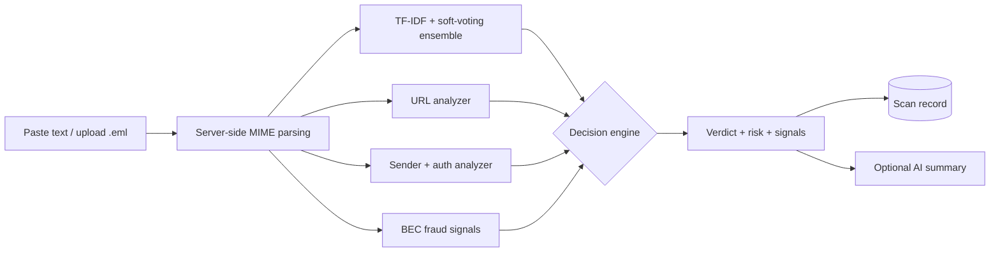

<div align="center">

# Email Phishing Detection System

**Traceable verdicts. Honest scores. Evidence you can inspect.**

[](https://github.com/PrathamWankhade/email-phishing-detection-system/actions/workflows/ci.yml)
[](https://python.org)
[](https://fastapi.tiangolo.com)
[](https://react.dev)
[](https://scikit-learn.org)
[](LICENSE)

*React scanner and dashboard · FastAPI backend · scikit-learn classifier with
URL, sender, authentication and fraud signals · optional LLM explanations*

</div>

---

## Table of contents

- [Why this exists](#why-this-exists)
- [How detection works](#how-detection-works)
- [Quick start](#quick-start)
- [Configuration](#configuration)
- [API overview](#api-overview)
- [Evaluation](#evaluation)
- [Documentation](#documentation)
- [Project structure](#project-structure)
- [Status and roadmap](#status-and-roadmap)
- [Author](#author)

## Why this exists

Most phishing demos show a confidence percentage nobody validated. This
project is built around one principle:

> **Every verdict is traceable to evidence, and every score means exactly
> what the interface says it means.**

| Guarantee | How |
|---|---|
| Model probability and risk score stay separate | `phishing_probability` vs `risk_score` — distinct fields, distinct meanings |
| Risk starts from P(phishing), not max confidence | A 96%-legitimate email contributes ~4 points, never 96 |
| Deterministic evidence survives AI failure | LLM output is supplementary; it can never overwrite signals or verdict |
| No silent fallbacks | Backend down means an explicit error — never a disguised heuristic guess |
| Demo data is always labeled | Dashboard shows a Demo Mode badge when live data is unreachable |

## How detection works



1. **Parse** — `.eml` is parsed server-side (sender, subject, body, URLs,
   attachments, Reply-To/Return-Path). Malformed mail degrades gracefully.
2. **Classify** — TF-IDF (50k, 1–3 grams) plus soft-voting
   LogisticRegression/RandomForest returns a binary class and P(phishing).
3. **Corroborate** — URL (one record per URL), sender domain, header
   authentication, and BEC/fraud analyzers add bounded, evidence-tagged risk.
4. **Decide** — `risk = P(phishing)*100 + url(<=20) + sender(<=30) +
   evidence(<=10)`; thresholds >= 75 Phishing, >= 45 Suspicious (interim,
   pending held-out validation).
5. **Explain and persist** — deterministic signals are the source of truth;
   the LLM may add a summary; the scan is stored by content hash.

> [!NOTE]
> `risk_score` is a heuristic policy score, **not a calibrated
> probability**. The UI labels it "Risk score" and shows P(phishing)
> separately. See [docs/API_Documentation.md](docs/API_Documentation.md).

## Quick start

Prerequisites: Python 3.11+, Node.js 20+. An OpenRouter key is optional —
without it the system runs fully local.

```bash
# Backend — http://127.0.0.1:8000 (docs at /docs)
python -m venv .venv
.venv\Scripts\Activate.ps1        # Windows  |  source .venv/bin/activate (Linux/Mac)
pip install -r requirements.txt
cp .env.example .env              # set OPENROUTER_API_KEY / API_KEYS as needed
python scripts/verify_setup.py    # checks dataset + artifacts, prints fixes
uvicorn backend.app.main:app --reload

# Frontend — http://localhost:3000
npm install
npm run dev

# Tests (full suite needs trained_models/; CI runs the rest)
pytest tests/ -v
pytest tests/ -m "not model" -v   # artifact-free subset

# Docker — frontend :3000, API :8000
docker compose up --build
```

> [!WARNING]
> A clean clone cannot serve predictions until model artifacts exist (they
> are gitignored). Follow [docs/reproducibility.md](docs/reproducibility.md)
> to train or mount them, and confirm with `GET /ready`.

## Configuration

| Variable | Default | Effect |
|---|---|---|
| `OPENROUTER_API_KEY` | — | Enables AI summaries; unset = local-only, nothing leaves the server |
| `AI_EXPLANATIONS_ENABLED` | `true` | `false` forces local-only mode |
| `API_KEYS` | _(empty = open dev)_ | Gates history/dashboard/analytics/feedback via `X-API-Key` |
| `VITE_API_BASE_URL` / `VITE_API_KEY` | local / empty | API origin and key baked into the SPA at build time |
| `DATABASE_PATH` | `./phishing_detection.db` | SQLite location (persisted volume in Docker) |

> [!CAUTION]
> `VITE_API_KEY` ships inside the public JS bundle — anyone can read it. It
> suits single-operator deployments only, never multi-user production. See
> [docs/security.md](docs/security.md).

## API overview

| Method | Endpoint | Description |
|---|---|---|
| `POST` | `/api/v1/predict` | Classify an email (+ optional header evidence) |
| `POST` | `/api/v1/upload` | Server-side `.eml` parsing with validation |
| `GET` | `/api/v1/history` | Scan history (auth-gated) |
| `GET` | `/api/v1/dashboard` | KPIs with explicit unique-vs-event counts (auth-gated) |
| `POST` / `GET` | `/api/v1/feedback`(`/stats`) | Analyst review loop (auth-gated) |
| `GET` | `/health` · `/ready` | Liveness vs model-readiness probes |

Full contract with examples: [docs/API_Documentation.md](docs/API_Documentation.md).

## Evaluation

Measured on the 39,148-mail stratified holdout (model `phase4` release,
`trained_models/model_metadata.json`):

| Metric | Value |
|---|---|
| CV F1-macro (5-fold, Pipeline) | 98.14% |
| Test accuracy | 98.25% |
| Phishing precision / recall / F1 | 97.8% / 98.4% / 98.1% |
| False-positive / false-negative rate | 1.85% / 1.62% |
| Log loss / Brier score | 0.086 / 0.018 |

Policy verdicts (thresholds 75/45, text-only) on the same holdout:
precision 99.5%, recall 93.3% — the policy trades recall for precision; see
`reports/policy_validation.json`. Full protocol:
[docs/model_evaluation.md](docs/model_evaluation.md).

## Documentation

| Guide | Covers |
|---|---|
| [Architecture](docs/architecture.md) | Layers, decision engine, patterns |
| [System Design](docs/system_design.md) | Deployment, environments, scaling |
| [Workflow](docs/workflow.md) | Scan, upload, analytics, feedback, retrain |
| [Database Design](docs/database_design.md) | Schema and counting semantics |
| [Security](docs/security.md) | Auth, privacy, abuse controls |
| [Model Evaluation](docs/model_evaluation.md) | Metrics and protocol |
| [Reproducibility](docs/reproducibility.md) | Artifacts, setup verification |

## Project structure

```
frontend/src/          # React SPA — Scanner, Dashboard, UploadEmail, api.js
backend/app/
  api/routes/          # predict, upload, history, dashboard, analytics, feedback
  services/            # phishing_detector (decision engine), url/sender/auth/bec
  utils/email_parser.py# standards-aware MIME parsing
  middleware/auth.py   # optional API-key gate
ai-engine/training/    # build_final_dataset, train_model, evaluate, source_split_eval
tests/                 # phase1/2/3 contract tests + unit suites (model-marked)
scripts/               # verify_setup.py (executable onboarding check)
docker/ + compose      # backend image, SPA + Nginx, volumes, healthchecks
```

## Status and roadmap

**Done:** unified verdict contract, phishing-probability risk base, URL
evidence model, explicit unavailable states, explanation resilience,
Pipeline-CV training, full-text dataset dedup, MIME parsing, upload
validation, dashboard semantics, Docker readiness, API-key gating, auth/BEC
signals, header forwarding, feedback loop, CI.

**Next:** retrained metrics publication, threshold re-validation, per-user
history isolation, Redis-backed rate limiting, SSRF-safe URL reputation,
transformer benchmark on the frozen test set.

## Author

**Pratham Wankhade** — [GitHub](https://github.com/PrathamWankhade) ·
[LinkedIn](https://www.linkedin.com/in/pratham-wankhade)

*Built as a production-style cybersecurity engineering project: measurable
detection, traceable evidence, honest interfaces.*
