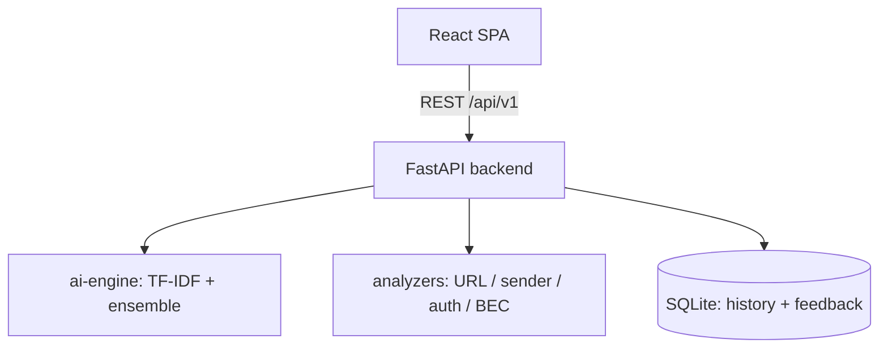
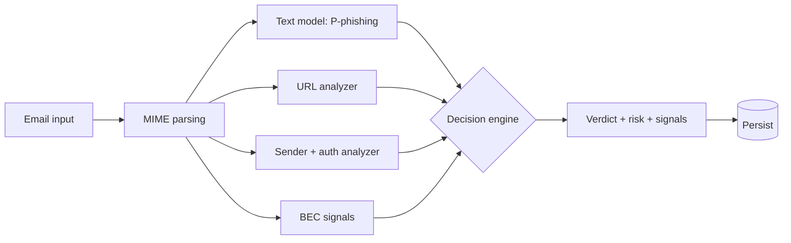

# Architecture

## Overview

The Email Phishing Detection System is a full-stack application with four
layers: a React single-page app, a FastAPI backend, a scikit-learn inference
engine, and a SQLite persistence layer. Everything runs from one repository
and ships as two containers (API + SPA behind Nginx).

```
React SPA ──REST /api/v1 (+ X-API-Key)──► FastAPI backend
                                              ├── routes → services → engine
                                              ├── ai-engine (TF-IDF + ensemble)
                                              ├── analyzers (URL / sender / auth / BEC)
                                              └── SQLite (history + feedback)
```



## The core design principle

One explicit decision engine, one response contract. The raw model output,
the heuristic signals, the combined risk score, the final verdict, and the
human-readable explanation are **separate fields** with documented meanings
(see [API Documentation](API_Documentation.md)). No component silently
overwrites another component's output:

| Field | Produced by | Meaning |
|---|---|---|
| `model_prediction` / `model_confidence` | ML classifier only | Raw binary class + probability. Never modified by heuristics. |
| `signals` / `reasons` | Deterministic analyzers | Traceable evidence strings. Never replaced by the LLM. |
| `risk_score` / `risk_level` | Decision policy | Heuristic policy score (0–99), **not** a calibrated probability. |
| `verdict` / `label` | Decision policy | Final Safe / Suspicious / Phishing label from risk thresholds. |
| `ai_explanation` | External LLM (optional) | Supplementary summary. Cannot change the verdict. |

## Backend layout

```
backend/app/
├── api/routes/      # Thin HTTP adapters (predict, upload, history,
│                    # dashboard, analytics, feedback, health)
├── api/router.py    # Route aggregation under /api/v1
├── services/        # Detection logic
│   ├── phishing_detector.py  # THE decision engine (policy vX)
│   ├── url_analyzer.py       # Per-URL findings, unique-URL counting
│   ├── sender_analyzer.py    # Domain / impersonation signals
│   ├── auth_analyzer.py      # Reply-To / SPF / DKIM / DMARC signals
│   ├── bec_analyzer.py       # Fraud-pattern signals
│   ├── explanation_engine.py # Deterministic signal aggregation
│   └── openrouter_explainer.py # Optional LLM summary (timeout-guarded)
├── utils/
│   └── email_parser.py  # Standards-aware MIME parsing (email.policy.default)
├── controllers/     # Upload + analytics orchestration
├── database/        # SQLite (WAL), scan history + feedback tables
├── middleware/      # Optional API-key gate, error handling, logging
├── config/          # Prefixes, thresholds, environment settings
└── main.py          # App entrypoint: CORS, rate limit, body cap,
                     # /health (liveness) vs /ready (model readiness)
```

## Detection pipeline

```
Email Input → MIME Parsing → Text Model ─┐
                           → URL Analyzer ├→ Decision Engine → Verdict + Risk
                           → Sender/Auth  │         ↓
                           → BEC Signals ─┘   Deterministic Signals
                                                    ↓ (+ optional AI summary)
                                              Persist → Dashboard
```



1. **Input** — Pasted text (`POST /predict`) or `.eml` upload
   (`POST /upload`, parsed server-side with size/type validation).
2. **Model** — TF-IDF (50k, 1–3 grams) + soft-voting
   LogisticRegression/RandomForest. Returns a binary class and probability.
3. **Analyzers** — URL (one record per URL, hostname normalized, IDNA-aware),
   sender domain, header authentication, BEC/fraud patterns. Each returns
   capped risk points plus evidence strings.
4. **Decision engine** — `risk_score = P(phishing)*100 + url_risk (≤20) +
   sender_risk (≤30) + evidence_risk (≤10)`, capped at 99. Using the
   phishing-class probability (not max-class confidence) means confident
   legitimate mail contributes ~0, not ~96. Thresholds: ≥75 high
   (Phishing), ≥45 medium (Suspicious), else low (Safe) — interim values
   pending held-out validation.
5. **Explanation** — Deterministic signals are the source of truth. The LLM
   may add a supplementary summary; on provider failure the local result is
   returned unchanged with `explanation_source: "deterministic"`.
6. **Persistence** — Canonical email rows keyed by content hash with
   `scan_count`; analyst feedback stored in a separate table.

## Patterns used

- **Layered architecture** — routes, services, engine, and storage are
  independently testable (see `tests/test_phase*.py` for the contract tests).
- **Pipeline pattern** — parse → featurize → score → explain, with the
  vectorizer fitted inside each CV fold during training (no leakage).
- **Fail-open locally, fail-closed honestly** — provider/outage failures
  degrade to deterministic local results with an explicit status; the UI
  never presents a heuristic estimate as an ML verdict.

## Further reading

- [System Design](system_design.md) — deployment, environments, scaling
- [Workflow](workflow.md) — end-to-end flows
- [Model Evaluation](model_evaluation.md) — metrics and calibration
- [Security](security.md) — auth, privacy, limits
